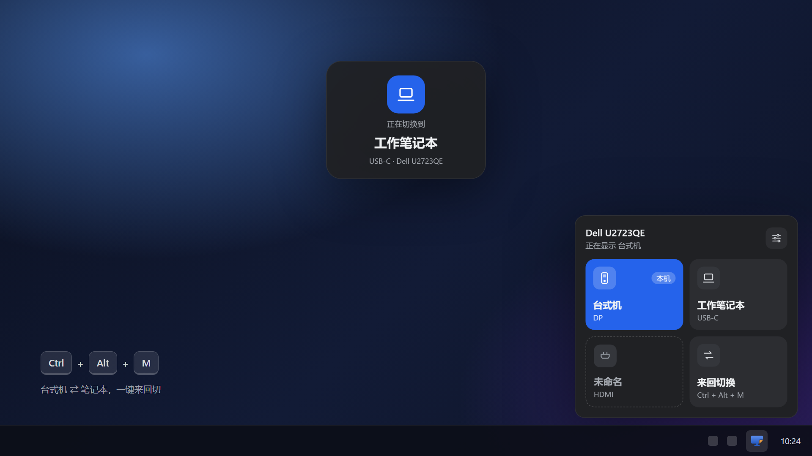
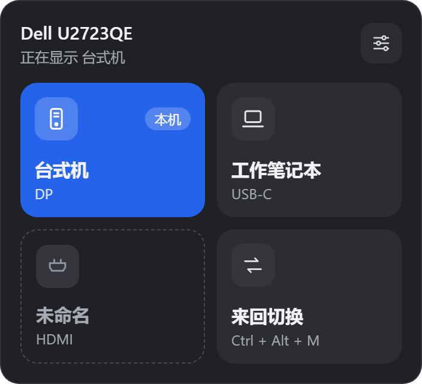
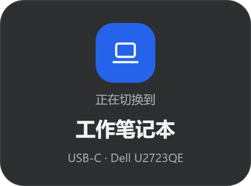
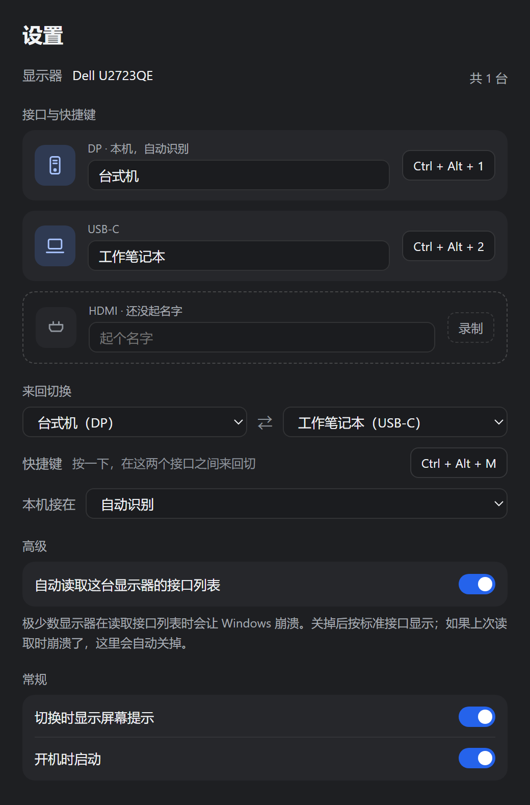
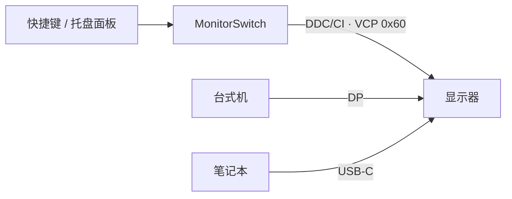

<div align="center">


# MonitorSwitch

**一台显示器，两台电脑，一个快捷键来回切。**

在托盘里切换显示器输入源，不用再伸手去摸显示器背后的按钮，也不用装厂商几百 MB 的配套软件。

[](https://github.com/shulkx/monitor-switch/releases/latest)




</div>

## 为什么做这个

台式机和笔记本共用一台显示器时，切换输入源要么按显示器背后的物理按键、在菜单里翻好几层，要么装显示器厂商的管理软件——体积大、常驻一堆服务，只为了换个输入口。

MonitorSwitch 只做这一件事：通过 **DDC/CI** 直接告诉显示器"换到哪个接口"，安装包约 3 MB，平时安静地待在托盘里。

## 功能

- 🖱️ **托盘面板**：左键托盘图标，点一下磁贴就切过去；当前显示的接口高亮显示
- ⌨️ **快捷键**：`Ctrl + Alt + M` 在两个接口之间来回切，还可以给每个接口录一个直达快捷键
- 🏷️ **认得你的设备**：自动识别本机接在哪个口，其他接口起个名字（"工作笔记本"）就不用记 DP / HDMI / USB-C
- 💬 **屏幕提示**：切走前提示"正在切换到…"，切回来提示"已切换到…"，提示框不抢键盘焦点
- 🔍 **快捷键冲突检测**：录制时如果组合键已被其他程序占用，当场提示；`Ctrl+C` 这类会抢走常用快捷键的组合直接拒绝
- 🖥️ **不只是 Dell**：读取显示器自己报告的接口列表，支持大部分带 DDC/CI 的外接显示器；多台显示器分标签页
- 🔌 **对 KVM 友好**：键盘接在显示器 USB 上也不怕，等你松开快捷键再切，Ctrl 不会"卡住"
- 🔔 **更新提醒**：有新版本时，托盘面板和右键菜单里会提示，点一下就下载、校验签名并装好，设置保留
- 🌙 **轻量**：Rust + 系统 WebView，不常驻额外服务；可设置开机启动

## 截图

<table>
  <tr>
    <td width="52%" valign="top" align="center">
      <br />
      <sub><b>托盘面板</b> · 点磁贴切换，本机接口带"本机"标记</sub>
      <br /><br />
      <br />
      <sub><b>屏幕提示</b> · 切换前后各出现一次</sub>
    </td>
    <td width="48%" valign="top" align="center">
      <br />
      <sub><b>设置</b> · 起名字、录快捷键、选来回切换的两个接口</sub>
    </td>
  </tr>
</table>

## 安装

1. 下载[最新版本](https://github.com/shulkx/monitor-switch/releases/latest)里的 `MonitorSwitch_x.y.z_x64-setup.exe`，或者按下面的[开发](#开发)步骤自己构建。
2. 在资源管理器里双击安装。安装到当前用户目录，**不需要管理员权限**。
3. 安装包还没有代码签名，Windows 可能提示"Windows 已保护你的电脑"：点 **更多信息 → 仍要运行**。
4. 在显示器的菜单里确认 **DDC/CI** 已开启（大多数显示器默认开启）。

> 💡 共用这台显示器的每台电脑都装一份。每台电脑都能自动认出自己接在哪个口上。

## 使用

| 操作 | 效果 |
| --- | --- |
| 左键托盘图标 | 打开面板，点磁贴切换 |
| 右键托盘图标 | 菜单里直接选接口；设置；退出 |
| `Ctrl + Alt + M` | 在"来回切换"的两个接口之间切换 |
| 每个接口的直达快捷键 | 在设置里录制，例如 `Ctrl + Alt + 1` 切到台式机 |

**设置里可以：** 给接口起名字 · 录快捷键（`Backspace` 清除、`Esc` 取消）· 选来回切换的两个接口 · 手动指定本机接口 · 开关屏幕提示 · 开机启动。

**更新：** 启动 30 秒后和之后每 6 小时检查一次 GitHub Releases，只提醒不自动下载。设置 → 关于里可以手动检查，或关掉"自动检查更新"。

**命令行：** `monitor-switch.exe --settings` 打开设置，`monitor-switch.exe --quit` 退出正在运行的程序（升级前用它，托盘不会留下残影）。

## 常见问题

<details>
<summary><b>面板里提示"没找到能控制的显示器"</b></summary>

- 在显示器菜单里打开 **DDC/CI**。
- 部分扩展坞、转接头、KVM 切换器不转发 DDC/CI 信号，换成直连试试。
- 笔记本自带屏幕不支持 DDC/CI，只有外接显示器能切。
</details>

<details>
<summary><b>切到另一台电脑后，怎么切回来？</b></summary>

两台电脑都装上 MonitorSwitch，在哪台上按快捷键都行。很多显示器在显示别的输入时仍然接受 DDC/CI 指令，所以原来那台电脑上的快捷键通常也能把画面切回来。
</details>

<details>
<summary><b>快捷键按了没反应</b></summary>

多半是被其他程序先占用了。设置页会在对应的快捷键下面用红字标出，托盘面板的"来回切换"磁贴也会提示，重新录一个就行。
</details>

<details>
<summary><b>切换后键盘好像一直按着 Ctrl</b></summary>

如果键盘接在显示器的 USB 口上，显示器的 KVM 会让键盘跟着输入源一起走。MonitorSwitch 会等你松开快捷键再发切换指令，避免这个问题；如果仍遇到，请提 Issue。
</details>

<details>
<summary><b>点"更新"后发生了什么？</b></summary>

MonitorSwitch 下载新版安装包，用内置的公钥校验签名（不对就拒绝安装），然后退出并运行安装包：只有一个小进度条，装完自动重新打开，设置都保留。如果失败了，点"去下载页"手动下载安装即可。0.1.1 及更早的版本没有更新功能，需要手动装一次 0.1.2。
</details>

<details>
<summary><b>读取接口列表时 Windows 卡死或崩溃</b></summary>

极少数显示器回应"接口列表"请求时会出问题。MonitorSwitch 会在读取前留下标记，如果上次读取时崩溃了，会自动关掉这项功能，改用标准接口列表；也可以在 **设置 → 高级** 里手动关闭。
</details>

## 工作原理



- **切换**：通过 DDC/CI 写显示器的 MCCS 功能码 `0x60`（Input Select），例如 `0x0F` = DP、`0x11` = HDMI、`0x1B` = USB-C。写完 1.5 秒后读回确认，失败会重试。
- **接口列表**：读取显示器的 capabilities 字符串，只显示它真正有的接口。
- **认出显示器**：用 EDID 里的厂商、型号、序列号生成唯一标识，换线、换口后设置不会丢。
- **认出本机**：从 Windows 的显示拓扑读取本机的连接方式（HDMI / DP / USB-C 隧道），再结合是不是笔记本，推断本机接在哪个口。
- **发现外部切换**：每 4 秒读一次当前输入源，用显示器按键切换也能同步到面板上。

## 开发

需要 [Rust](https://rustup.rs/)（stable）、Node.js 20+ 和 WebView2（Windows 10/11 一般已自带）。

```bash
npm install
npm run tauri dev                              # 开发模式运行
cargo test --manifest-path src-tauri/Cargo.toml  # 单元测试
npm run test:scripts                           # 发布脚本的签名校验测试
npm run tauri build                            # 生成安装包 src-tauri/target/release/bundle/nsis/
```

```text
src/                    界面（TypeScript + Vite，无框架）
├─ flyout/              托盘面板
├─ osd/                 屏幕提示
├─ settings/            设置页
└─ shared/              API、图标、主题
src-tauri/src/          后端（Rust）
├─ app/                 托盘、窗口、快捷键动作
├─ ddc/                 DDC/CI 能力字符串解析、后端接口
├─ platform/win/        Win32：DDC/CI、显示拓扑、EDID、键盘
├─ monitor_service.rs   轮询、切换、校验、重试
├─ config.rs            设置读写（%APPDATA%\MonitorSwitch\config.json）
└─ hotkeys.rs           快捷键绑定与冲突检查
```

图标有两份源文件：`src-tauri/icons/icon.svg`（精细版，32 px 以上）和 `icon-small.svg`（按 16 像素网格画，托盘和 16–24 px 小图标用）。修改后运行 `npm run icons`，会重新生成所有尺寸、多尺寸的 `icon.ico` 和 `icons/tray/` 里的托盘图标；程序启动时按系统缩放挑对应尺寸的托盘图标，不会被缩放糊掉。设计文档见 [`docs/superpowers/specs`](docs/superpowers/specs/2026-11-12-monitorswitch-tray-design.md)。

### 发布

```bash
npm run release -- --notes notes.md            # 带签名构建，校验签名，生成 latest.json
npm run release -- --notes notes.md --publish  # 同时创建 GitHub Release
```

更新包用 `%USERPROFILE%\.tauri\monitor-switch.key` 签名（也可以用环境变量 `TAURI_SIGNING_PRIVATE_KEY` 提供），对应的公钥写在 `tauri.conf.json` 里。私钥不在仓库里，**务必另外备份**：丢了以后，已安装的程序就收不到更新了。发布前先把 `tauri.conf.json`、`Cargo.toml`、`package.json` 的版本号改成一致；脚本会检查。没有私钥也能用 `npm run tauri build` 正常构建，只是不生成更新包。

## 路线图

- [x] Windows：托盘面板、快捷键、屏幕提示、本机识别、冲突检测
- [x] 更新提醒，带签名校验
- [ ] 识别新插入的设备并提示命名、自动学习每台设备接在哪个口
- [ ] 显示"未连接"的显示器；锁屏时暂停轮询
- [ ] 局域网内多台电脑互相发现
- [ ] macOS / Linux 支持、在 CI 里自动构建发布

## 致谢

- [Tauri](https://tauri.app/) —— 用系统 WebView 做出小体积的桌面应用
- [VESA MCCS](https://vesa.org/) 规范，以及 [ddcutil](https://www.ddcutil.com/)、[ControlMyMonitor](https://www.nirsoft.net/utils/control_my_monitor.html) 等前辈工具
